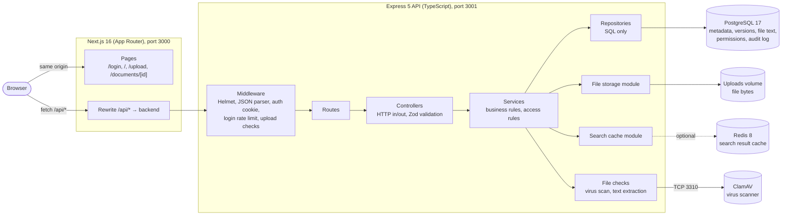
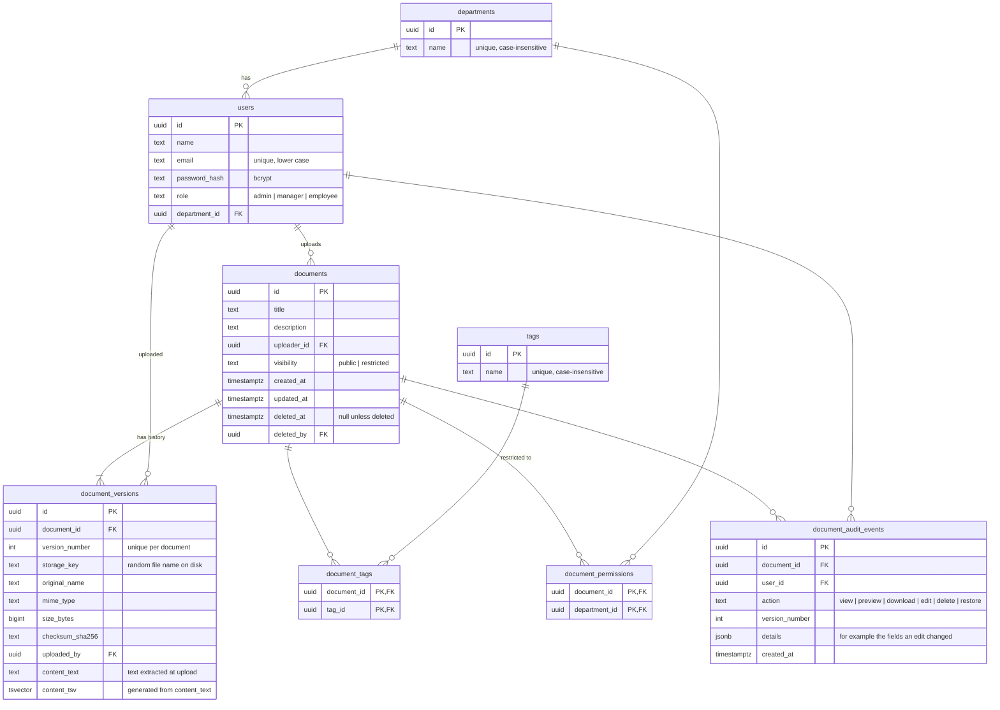
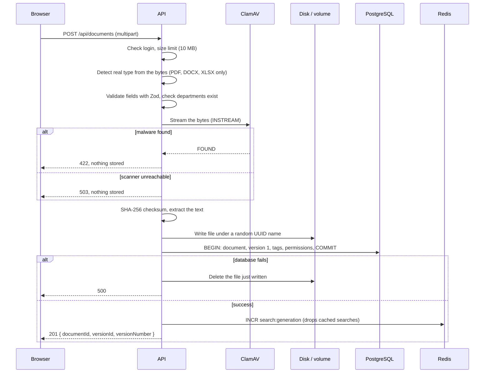
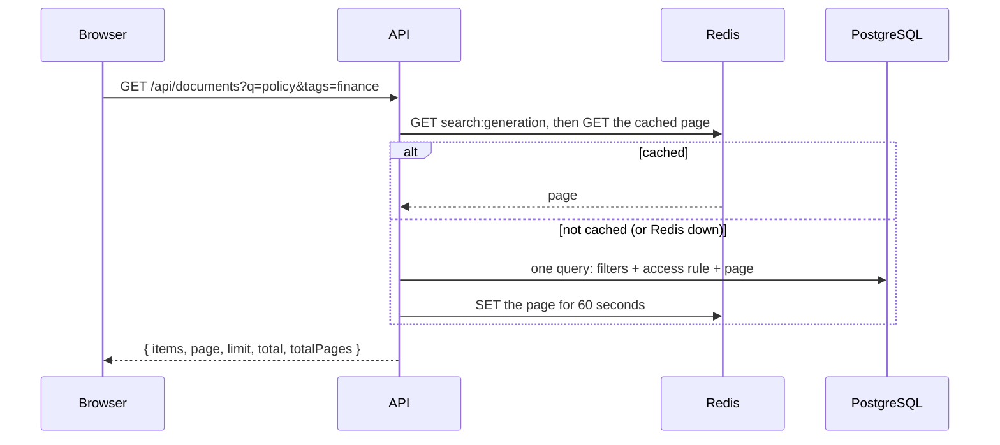

# Architecture and design choices

A document repository where employees upload, version, search, and download corporate documents, with access limited by department.

## 1. System overview

- **The browser only talks to port 3000.** Next.js forwards `/api/*` to the API, so everything is same-origin. No CORS setup is needed, and the httpOnly session cookie works without extra configuration.
- **The API has four layers**: routes wire URLs to controllers, controllers only deal with HTTP, services hold the business rules, and repositories contain only SQL. Each layer calls only the one below it.
- **There are three stores, each with one job.** PostgreSQL holds everything that must be correct (metadata, versions, the text inside each file, permissions, audit), the uploads volume holds file bytes, and Redis holds disposable copies of search results.
- **ClamAV scans every upload** before anything is stored.
- **Interactive API docs** (Swagger UI) are served at `/api/docs`.

Everything runs with Docker Compose. `docker compose up -d` starts PostgreSQL and Redis for local development, and `docker compose --profile app up -d --build` runs the whole system, ClamAV included. The demo seed adds four users and six documents (public, Finance-only, Legal-only, Finance + Legal, HR-only), so the permission rules can be tried straight after a fresh clone.

## 2. Database schema

How the schema covers the brief:

| Requirement | Where it lives |
|---|---|
| Users with department and role | `users.department_id`, `users.role` (checked with a constraint) |
| Many tags per document | `tags` plus the `document_tags` join table. Tags are stored once and matched case-insensitively. |
| A new version replaces the old one, history kept | One `document_versions` row per upload. The **current version is the highest `version_number`**. Rows are never updated or deleted. |
| Some documents restricted to departments | `documents.visibility = 'restricted'` plus one `document_permissions` row per allowed department |

**Indexes on the searched columns.**

| Search or lookup | Index |
|---|---|
| Title (partial match) | Trigram GIN on `documents.title`. `ILIKE '%term%'` can use it, unlike a normal B-tree. |
| Words inside files | GIN on `document_versions.content_tsv` (full-text search) |
| "Is this exact file already here?" | `document_versions(checksum_sha256)` |
| "Which version did this user last download?" | Partial index on `document_audit_events(user_id, document_id, version_number)` for downloads |
| Uploader name (partial match) | Trigram GIN on `users.name` |
| Tags | Unique index on `lower(tags.name)`, plus `document_tags(tag_id)` for "all documents with this tag" |
| Department permissions | `document_permissions(department_id)` |
| Sorting the list | `documents(updated_at DESC, id)`, matching the API's fixed sort |
| Foreign keys | Every foreign key column has its own index |

Migrations are plain numbered SQL files (`backend/migrations/001` to `007`). A small runner applies each one in a transaction and records it in `schema_migrations`.

## 3. Key flows

### Uploading a document (or a new version)

- **Files and the database stay consistent without a shared transaction.** The file is written first, and if the database transaction fails, the file is deleted. The worst case is a crash between the two steps, which leaves an unreferenced file on disk. That is harmless, and a periodic cleanup could remove it. The reverse order could leave a database row pointing to a file that doesn't exist, which is worse.
- **New versions** lock the document row (`SELECT … FOR UPDATE`) before computing `MAX(version_number) + 1`. Simultaneous uploads therefore get distinct, gap-free numbers. A test runs five at once to check this.
- **A new version identical to the current one is refused** (`409`), because it would add nothing. Going back to an *older* file is allowed.
- **The upload form warns about duplicates before sending.** The browser computes the file's SHA-256 and asks `GET /api/documents/duplicates`, which only ever lists documents the user can already see.

### Searching

- **Filters:** title (partial, case-insensitive) **or words inside the file**, tags (a document must have **all** the listed tags), and uploader name (partial). Results are paginated, with at most 50 per page.
- **Searching inside files.** At upload, the text is pulled out of the file (PDF with pdf.js, DOCX and XLSX by unzipping their XML) and stored with the version. PostgreSQL keeps a generated `tsvector` of it with a GIN index. Each search word becomes a prefix match (`reconcil:*`), so results appear while typing and "approve" finds "approved". Only the **current** version's text is searched. Matching results carry a snippet with the matched words marked; the frontend renders it as text pieces, never as HTML.
- **"New version since your download."** Each result says which version the user last downloaded. This is personal and changes with every download, so it is added *after* the cache with one small indexed query, instead of being stored in the shared cache.
- The **access rule is part of the SQL `WHERE` clause**, so hidden documents never appear in results, totals, or page counts.
- Every user value is a `$n` parameter, and `%`, `_` and `\` are escaped in LIKE patterns. For full-text search only letters and digits are kept, so no `tsquery` syntax can be injected. Tests send SQL injection strings through every filter.

## 4. Design choices

**File bytes on disk, metadata in PostgreSQL.** Databases are poor at storing large blobs: backups grow, and memory fills up. All file access goes through one module (`storage/fileStorage.ts`, with `saveFile`, `openFile`, `deleteFile`, and `fileExists`). Moving to S3 or Azure Blob means rewriting that one file; nothing else changes. Files are stored under random UUID names, so user-supplied names never reach the file system.

**The current version is the highest number, not a pointer column.** A `documents.current_version_id` column would create a circular foreign key (documents to versions to documents) and a second value that must be kept in sync. Using "the highest `version_number`" means there is only one source of truth. Version rows are never changed, so the history is immutable.

**Only the current version can be downloaded.** The brief says a new version *replaces* the old one while the history is kept. Old versions therefore stay visible in the history (number, file name, size, checksum, uploader, date), but `GET /download?version=<older>` returns `403`. This is enforced in the API, not just hidden in the UI.

**Hidden documents return `404`, not `403`.** If a user can't see a document, the API answers exactly as it would for an id that doesn't exist, so restricted documents can't be discovered by guessing ids. `403` is used only when a user *can* see a document but may not do something to it, such as adding a version to someone else's document.

**The access rule lives in one place.** A user can view a document if they are an admin, they uploaded it, it is public, or their department is in its permissions. This rule is written once in `accessService` and once in the search SQL. A test matrix of 4 users × 4 documents × 2 endpoints locks both copies to the same answers.

**Sessions are a short JWT in an httpOnly cookie, and the user is reloaded on every request.** The token holds only the user id and lasts 1 hour. The cookie is httpOnly (JavaScript can't read it), `SameSite=Lax` (protects against CSRF), and Secure over HTTPS. Because the user is loaded from the database on each request, role or department changes apply immediately, and deleted users are locked out at once.

**Search caching is keyed by the person asking.** Two users in the same department and role can see different results, because uploaders always see their own restricted documents. Cache keys therefore include the user id; admins, who see everything, share one key. Instead of deleting keys one by one, each upload increments a generation number that is part of every key. Entries expire after 60 seconds anyway, and Redis is capped at 128 MB with LRU eviction. If Redis is unavailable, requests go straight to PostgreSQL and the app keeps working.

**Validation happens in the API, not just in the forms.** Zod schemas validate every body, query, and id. Uploads are checked by their **content**, not by file name or `Content-Type` (a text file renamed `.pdf` returns `415`), and are limited to 10 MB (`413`). Every error uses the same shape, `{ "error": { "code", "message" } }`:

| Status | Meaning |
|---|---|
| `400` | Invalid input, malformed id, broken JSON, unknown department |
| `401` | Not logged in |
| `403` | Visible but not allowed (adding a version, editing, deleting, downloading an old version, reading the audit log, admin-only actions) |
| `404` | Unknown, hidden or deleted |
| `409` | New version identical to the current one |
| `413` | Too large |
| `415` | Wrong file type |
| `422` | Malware found, or a file too damaged to preview |
| `429` | Too many failed logins |
| `503` | Virus scanner unreachable |

**Deleting is a soft delete.** `DELETE /api/documents/:id` sets `deleted_at`. From then on the document answers `404` for everyone, admins included, and leaves search at once. Its versions, files and audit trail stay, so nothing is lost by mistake, and an admin can restore it from the *Deleted* page. Every query filters on `deleted_at IS NULL`, and tests check each endpoint after a delete.

**Edits change only what differs.** `PATCH /api/documents/:id` accepts any of title, description, tags, visibility and departments. The service compares the request with the stored document, writes and audits only the real changes (`details.changes = ["title", "departments"]`), and drops the search cache, so a document made restricted disappears from other departments' results immediately.

**Virus scanning fails closed.** When ClamAV is configured but unreachable, uploads are refused with `503` instead of being stored unscanned. Scanning happens after the permission check (a refused upload is never sent to the scanner) and before anything touches the disk. In development without `CLAMAV_HOST` scanning is off, and the health check says `"virusScanner": "disabled"`.

**Every file type can be previewed, in a new tab.** Browsers can show PDFs but not Word or Excel files, so `GET /preview` sends PDFs as they are and turns DOCX (with mammoth) and XLSX (with the same unzip-and-read code as the text search) into a read-only web page. Everything taken from the file is escaped, `javascript:` links are removed, and the page carries its own `Content-Security-Policy: default-src 'none'`, so nothing in a file can run. Zip files are unpacked with size limits first, so a "zip bomb" can't exhaust memory. The frontend fetches the preview and opens it from a `blob:` URL, so a failure shows a message on the page instead of raw JSON. Downloads use the same fetch approach. Files are sent with `Cache-Control: private, no-store`.

Saving a file from the browser's PDF viewer doesn't reach the server, so it can't be logged as a download. The audit log records the *preview*, which is the moment the file left the server.

**Integrity checks use the stored checksum.** `GET /integrity` re-reads every stored version and compares it with the SHA-256 saved at upload, reporting each as intact, modified or missing.

**Plain SQL, no ORM.** The queries that matter most, such as search with the access rule, all-tags matching, and the "latest version" lateral join, are clearer and easier to tune as SQL. Repositories keep all of that SQL in one layer.

## 5. Security summary

- Passwords are hashed with bcrypt. A wrong email and a wrong password get the same message, and unknown emails are compared against a dummy hash so response times don't reveal which emails exist.
- Logins are rate-limited: after 10 failed attempts per email and IP within 15 minutes, further attempts return `429`. Successful logins don't count.
- Helmet sets the security headers, and `X-Powered-By` is removed.
- Every upload is scanned by ClamAV (inside DOCX and XLSX zips too); infected files are refused and logged.
- Downloads are sent as `Content-Disposition: attachment` with `nosniff`, so the browser never runs an uploaded file as a page. Previews are inline but sandboxed by their CSP.
- An audit log (`document_audit_events`) records views, previews, downloads, edits, deletes and restores, with the version. The uploader or an admin sees it as the *Activity* panel on the document page, or at `GET /api/documents/:id/audit`.

## 6. Testing

The backend has 315 tests in 15 files (Vitest and Supertest), and GitHub Actions runs them on every push together with the frontend lint and build. They run against a separate `document_repository_test` database and Redis database 1, and they refuse to run unless the database name ends in `_test`. They cover:

- login and sessions;
- the full permission matrix;
- uploads (types, limits, validation, concurrent versions, cleanup when the database fails);
- search (pagination, filters, SQL injection, LIKE wildcards);
- downloads (bytes, headers, the old-version rule, missing files);
- hardening (bad JSON, headers, rate limiting);
- the audit log;
- the cache (hits, invalidation, no cross-user leaks, Redis outage);
- editing, deleting and restoring (permissions, validation, cache invalidation, audit);
- searching inside files (all three formats, snippets, current version only, no leaks through contents, hostile input);
- virus scanning, against a small fake ClamAV that speaks the real protocol (infected, clean, unreachable, hanging);
- previews of all three file types (escaping, unsafe links, broken files, zip bombs), integrity checks, duplicates and the "new version since your download" flag;
- the API docs (a test reads the route files and fails if any route is missing from the OpenAPI document).

Key tests were checked by breaking the code on purpose (for example removing the "current version only" rule, or letting the scanner fail open) and confirming they fail.

## 7. Scaling path

The POC runs as one API instance. Here is how each part would grow:

| Concern | Now | At scale |
|---|---|---|
| File bytes | Local volume | Object storage (S3 or Azure Blob) behind the same storage module, with pre-signed download URLs |
| API | One container | Several stateless containers behind a load balancer. Sessions are already stateless (JWT); the login rate limiter would move to a Redis store. |
| Search | Trigram indexes on titles and names; full-text search on file contents | A search engine such as OpenSearch if relevance ranking or very large volumes are needed |
| Uploads | Scanned and text-extracted inside the request | A queue: store as "pending", scan and extract in a worker, then publish. ClamAV can run as several instances behind a load balancer. |
| Reads | Redis cache for search pages | The same, plus read replicas for PostgreSQL |
| Pagination | `LIMIT`/`OFFSET` | Keyset pagination on `(updated_at, id)`, which the new index already supports |

## 8. Known limitations

- Scanned PDFs (images of text) have no text to extract, so they can't be found by their contents; OCR would be the next step.
- Spreadsheet previews show stored values without number formats (a date appears as Excel's day number), up to 500 rows and 50 columns per sheet. Word previews keep text, headings, lists, tables and images, but not the exact page layout.
- Search results keep a fixed newest-first order; content matches are not ranked by relevance.
- Tokens can't be revoked before they expire (1 hour). Deleted users are still rejected immediately.
- The login rate limiter keeps its counts in memory, so they reset on restart and aren't shared between instances.
- A file removed from disk by hand is only detected when someone tries to download it (`404`).
