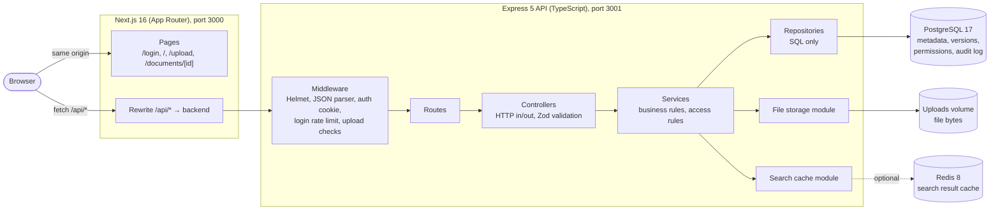
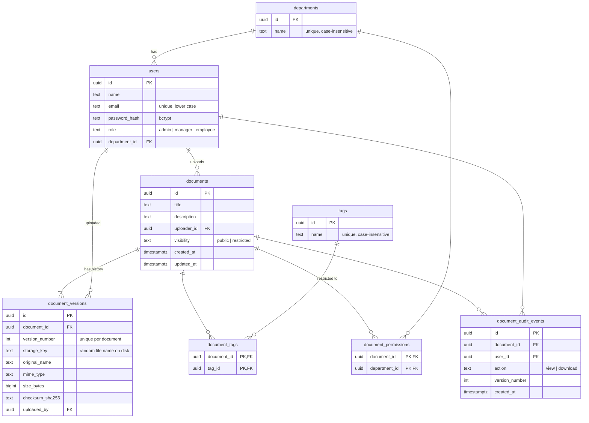
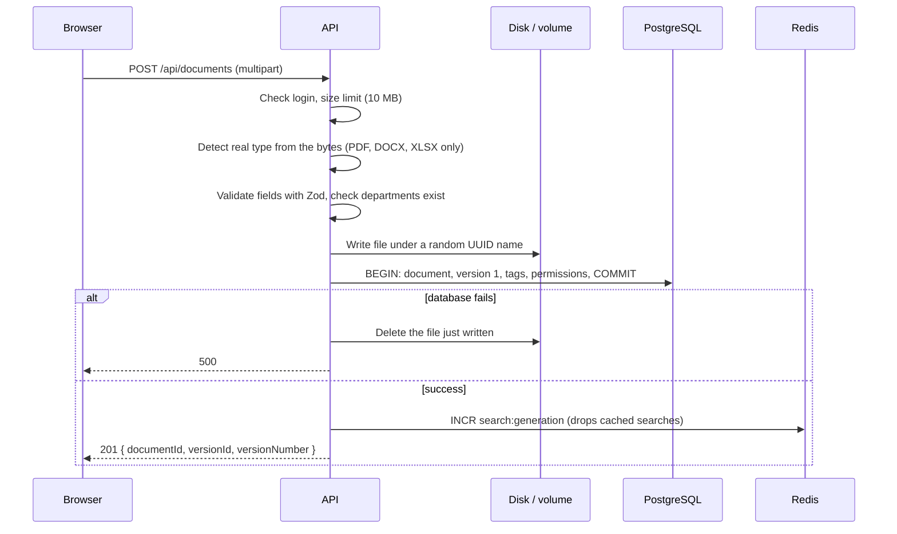
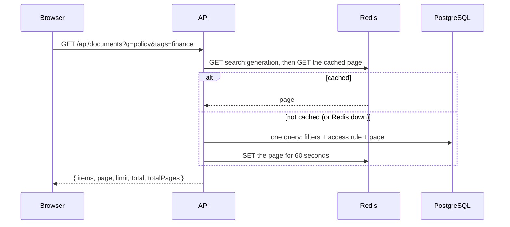

# Architecture and design choices

A document repository where employees upload, version, search, and download corporate documents, with access limited by department.

## 1. System overview

- **The browser only talks to port 3000.** Next.js forwards `/api/*` to the API, so everything is same-origin. No CORS setup is needed, and the httpOnly session cookie works without extra configuration.
- **The API has four layers**: routes wire URLs to controllers, controllers only deal with HTTP, services hold the business rules, and repositories contain only SQL. Each layer calls only the one below it.
- **There are three stores, each with one job.** PostgreSQL holds everything that must be correct (metadata, versions, permissions, audit), the uploads volume holds file bytes, and Redis holds disposable copies of search results.

Everything runs with Docker Compose. `docker compose up -d` starts PostgreSQL and Redis for local development, and `docker compose --profile app up -d --build` runs the whole system.

## 2. Database schema

How the schema covers the brief:

| Requirement | Where it lives |
|---|---|
| Users with department and role | `users.department_id`, `users.role` (checked with a constraint) |
| Many tags per document | `tags` plus the `document_tags` join table. Tags are stored once and matched case-insensitively. |
| A new version replaces the old one, history kept | One `document_versions` row per upload. The **current version is the highest `version_number`**. Rows are never updated or deleted. |
| Some documents restricted to departments | `documents.visibility = 'restricted'` plus one `document_permissions` row per allowed department |

**Indexes on the searched columns.**

| Search or lookup | Index |
|---|---|
| Title (partial match) | Trigram GIN on `documents.title`. `ILIKE '%term%'` can use it, unlike a normal B-tree. |
| Uploader name (partial match) | Trigram GIN on `users.name` |
| Tags | Unique index on `lower(tags.name)`, plus `document_tags(tag_id)` for "all documents with this tag" |
| Department permissions | `document_permissions(department_id)` |
| Sorting the list | `documents(updated_at DESC, id)`, matching the API's fixed sort |
| Foreign keys | Every foreign key column has its own index |

Migrations are plain numbered SQL files (`backend/migrations/001` to `006`). A small runner applies each one in a transaction and records it in `schema_migrations`.

## 3. Key flows

### Uploading a document (or a new version)

- **Files and the database stay consistent without a shared transaction.** The file is written first, and if the database transaction fails, the file is deleted. The worst case is a crash between the two steps, which leaves an unreferenced file on disk. That is harmless, and a periodic cleanup could remove it. The reverse order could leave a database row pointing to a file that doesn't exist, which is worse.
- **New versions** lock the document row (`SELECT … FOR UPDATE`) before computing `MAX(version_number) + 1`. Simultaneous uploads therefore get distinct, gap-free numbers. A test runs five at once to check this.

### Searching

- **Filters:** title (partial, case-insensitive), tags (a document must have **all** the listed tags), and uploader name (partial). Results are paginated, with at most 50 per page.
- The **access rule is part of the SQL `WHERE` clause**, so hidden documents never appear in results, totals, or page counts.
- Every user value is a `$n` parameter, and `%`, `_` and `\` are escaped in LIKE patterns. Tests send SQL injection strings through all three filters.

## 4. Design choices

**File bytes on disk, metadata in PostgreSQL.** Databases are poor at storing large blobs: backups grow, and memory fills up. All file access goes through one module (`storage/fileStorage.ts`, with `saveFile`, `openFile`, `deleteFile`, and `fileExists`). Moving to S3 or Azure Blob means rewriting that one file; nothing else changes. Files are stored under random UUID names, so user-supplied names never reach the file system.

**The current version is the highest number, not a pointer column.** A `documents.current_version_id` column would create a circular foreign key (documents to versions to documents) and a second value that must be kept in sync. Using "the highest `version_number`" means there is only one source of truth. Version rows are never changed, so the history is immutable.

**Only the current version can be downloaded.** The brief says a new version *replaces* the old one while the history is kept. Old versions therefore stay visible in the history (number, file name, size, checksum, uploader, date), but `GET /download?version=<older>` returns `403`. This is enforced in the API, not just hidden in the UI.

**Hidden documents return `404`, not `403`.** If a user can't see a document, the API answers exactly as it would for an id that doesn't exist, so restricted documents can't be discovered by guessing ids. `403` is used only when a user *can* see a document but may not do something to it, such as adding a version to someone else's document.

**The access rule lives in one place.** A user can view a document if they are an admin, they uploaded it, it is public, or their department is in its permissions. This rule is written once in `accessService` and once in the search SQL. A test matrix of 4 users × 4 documents × 2 endpoints locks both copies to the same answers.

**Sessions are a short JWT in an httpOnly cookie, and the user is reloaded on every request.** The token holds only the user id and lasts 1 hour. The cookie is httpOnly (JavaScript can't read it), `SameSite=Lax` (protects against CSRF), and Secure over HTTPS. Because the user is loaded from the database on each request, role or department changes apply immediately, and deleted users are locked out at once.

**Search caching is keyed by the person asking.** Two users in the same department and role can see different results, because uploaders always see their own restricted documents. Cache keys therefore include the user id; admins, who see everything, share one key. Instead of deleting keys one by one, each upload increments a generation number that is part of every key. Entries expire after 60 seconds anyway, and Redis is capped at 128 MB with LRU eviction. If Redis is unavailable, requests go straight to PostgreSQL and the app keeps working.

**Validation happens in the API, not just in the forms.** Zod schemas validate every body, query, and id. Uploads are checked by their **content**, not by file name or `Content-Type` (a text file renamed `.pdf` returns `415`), and are limited to 10 MB (`413`). Every error uses the same shape, `{ "error": { "code", "message" } }`:

| Status | Meaning |
|---|---|
| `400` | Invalid input, malformed id, broken JSON, unknown department |
| `401` | Not logged in |
| `403` | Visible but not allowed (adding a version, downloading an old version, reading the audit log) |
| `404` | Unknown or hidden |
| `413` | Too large |
| `415` | Wrong file type |
| `429` | Too many failed logins |

**Plain SQL, no ORM.** The queries that matter most, such as search with the access rule, all-tags matching, and the "latest version" lateral join, are clearer and easier to tune as SQL. Repositories keep all of that SQL in one layer.

## 5. Security summary

- Passwords are hashed with bcrypt. A wrong email and a wrong password get the same message, and unknown emails are compared against a dummy hash so response times don't reveal which emails exist.
- Logins are rate-limited: after 10 failed attempts per email and IP within 15 minutes, further attempts return `429`. Successful logins don't count.
- Helmet sets the security headers, and `X-Powered-By` is removed.
- Downloads are sent as `Content-Disposition: attachment` with `nosniff`, so the browser never runs an uploaded file as a page.
- An audit log (`document_audit_events`) records every document view and download, including the version. The uploader or an admin can read it at `GET /api/documents/:id/audit`.

## 6. Testing

The backend has 191 integration tests (Vitest and Supertest). They run against a separate `document_repository_test` database and Redis database 1, and they refuse to run unless the database name ends in `_test`. They cover:

- login and sessions;
- the full permission matrix;
- uploads (types, limits, validation, concurrent versions, cleanup when the database fails);
- search (pagination, filters, SQL injection, LIKE wildcards);
- downloads (bytes, headers, the old-version rule, missing files);
- hardening (bad JSON, headers, rate limiting);
- the audit log;
- the cache (hits, invalidation, no cross-user leaks, Redis outage).

## 7. Scaling path

The POC runs as one API instance. Here is how each part would grow:

| Concern | Now | At scale |
|---|---|---|
| File bytes | Local volume | Object storage (S3 or Azure Blob) behind the same storage module, with pre-signed download URLs |
| API | One container | Several stateless containers behind a load balancer. Sessions are already stateless (JWT); the login rate limiter would move to a Redis store. |
| Search | PostgreSQL trigram indexes on titles and names | PostgreSQL full-text search (`tsvector`) for file contents first, then a search engine such as OpenSearch if needed |
| Reads | Redis cache for search pages | The same, plus read replicas for PostgreSQL |
| Pagination | `LIMIT`/`OFFSET` | Keyset pagination on `(updated_at, id)`, which the new index already supports |

## 8. Known limitations

- Search matches titles, tags, and uploader names, not the text inside files.
- Tokens can't be revoked before they expire (1 hour). Deleted users are still rejected immediately.
- The login rate limiter keeps its counts in memory, so they reset on restart and aren't shared between instances.
- A file removed from disk by hand is only detected when someone tries to download it (`404`).
